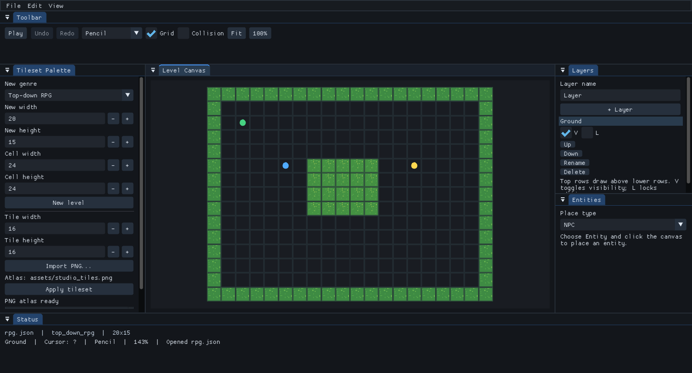
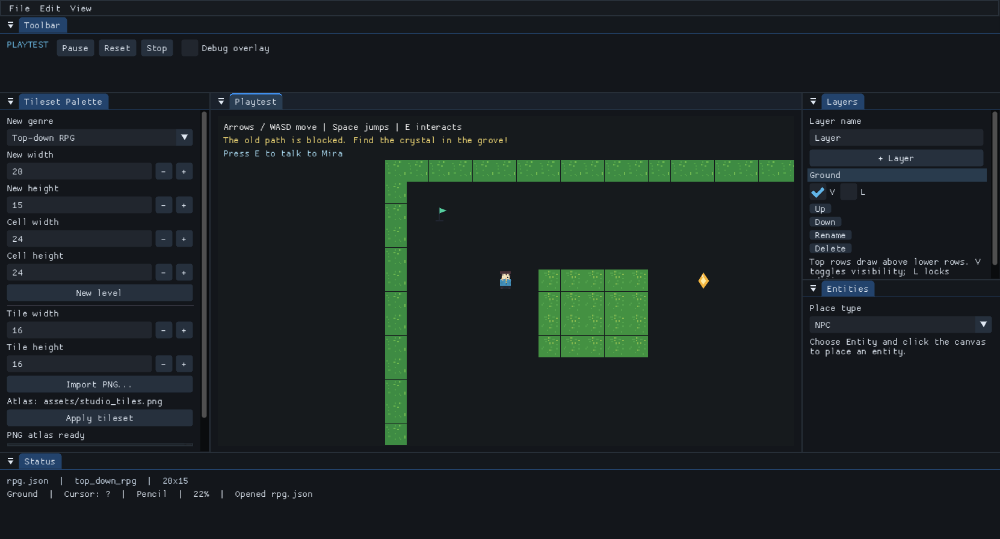
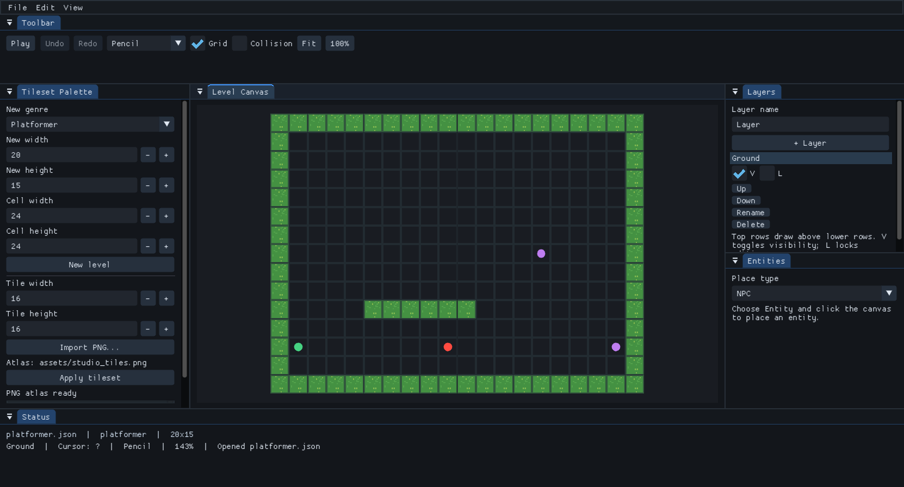
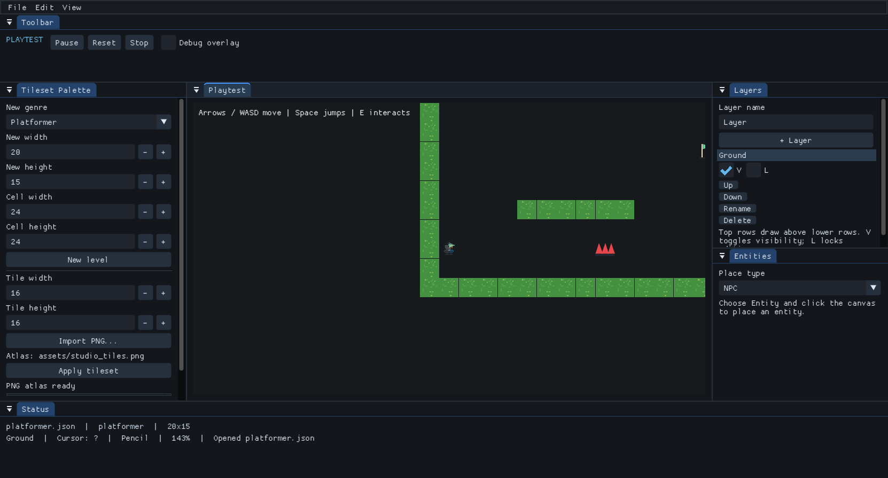

# PixelForge

**A native C++20 level editor for 2D top-down RPGs and platformers.** Build both genres in one SDL3 and Dear ImGui workspace, then playtest them using the same shared level model and JSON format.

## Screenshots

These are PNG captures read from the running PixelForge application, at 1662×896 and 100% UI scale.

| RPG editor | RPG playtest |
| --- | --- |
|  |  |
| Platformer editor | Platformer playtest |
|  |  |

## Windows download

The release candidate is built by GitHub Actions on Windows. Download the `PixelForge-v1.0.0-rc1-windows-x64` artifact from a successful run in [Actions](https://github.com/badmrfrosty313/PixelForge/actions/workflows/build.yml). It contains `PixelForge-v1.0.0-windows-x64.zip` and its SHA-256 file. Extract the ZIP and run `PixelForge.exe` from the extracted folder. No GitHub Release or final v1.0.0 tag has been published; the project-wide license is still awaiting maintainer approval.

## Quick Start

1. Launch PixelForge. The welcome window offers the RPG Village and Platformer Challenge demos.
2. Choose a demo, or use **File → New** to create a map and choose its genre and dimensions in the Tileset Palette.
3. Paint with the selected tile, use **Play** to try the level, and save with **Ctrl+S**.

The RPG demo introduces movement, Mira, and the Moon crystal. The platformer demo has a checkpoint, hazard gap, and finish marker. Both demos use the same editor, level model, and serializer.

## Editing controls

- **Pencil:** click or drag to paint; a drag is one undoable stroke.
- **Eraser, Rectangle, Line, Flood Fill, Eyedropper:** choose from the Tool selector.
- **Collision:** select the Collision tool and paint solid cells; toggle the overlay to inspect them.
- **Entities:** select an entity type and click the map to place it; select and drag a marker to move it. The inspector edits names and messages.
- **Layers:** create, rename, reorder, hide, lock, select, and delete layers. A level always keeps one layer.
- **View:** click **Fit** to frame and center the whole map; use **100%** to reset zoom. The wheel zooms at the cursor, and middle-drag pans.
- **History:** Ctrl+Z undoes; Ctrl+Y or Ctrl+Shift+Z redoes. Undo and redo are also in the Edit menu.
- **Files:** Ctrl+O opens a level, Ctrl+S saves, Ctrl+Shift+S opens Save As, and Ctrl+N creates a level. Native file dialogs are used on Windows.
- **Playtest:** focus the canvas and use WASD or the arrow keys to move; Space or Up jumps in platformer levels; E interacts with nearby RPG characters. Pause, Reset, and Stop are in the toolbar.

## Architecture

- `application`: SDL3 window and renderer lifecycle, Dear ImGui setup, event loop, screenshots, and Visual QA reporting.
- `editor`: shared dockable workspace, responsive panels, grid view, tools, map transforms, and playtest presentation.
- `document`: renderer-independent editing commands, grouped strokes, dirty state, and bounded undo/redo history.
- `level`: validated shared tile, layer, collision, asset-reference, and entity data model.
- `serialization`: strict versioned JSON parsing, validation, migrations, and atomic file replacement.
- `tileset` and `rendering`: PNG atlas slicing, SDL texture ownership, and drawing helpers.
- `gameplay`: isolated runtime copies, fixed 60 Hz simulation, shared collision handling, and genre-specific RPG and platformer controllers.

The editor owns SDL and ImGui resources through RAII. The level, document, serializer, and gameplay rules remain independent of graphics APIs. Version 2 JSON stores genre, map and tile dimensions, a relative tileset reference, ordered layer state and tile data, collision cells, and typed entities. Version 1 files remain readable. Rooted asset paths and parent-directory traversal are rejected.

## Build from source

Dependencies are pinned in CMake FetchContent declarations. The first configure requires Git and network access; subsequent builds reuse `build/_deps`.

**Windows** (Visual Studio 2022 with Desktop development with C++, CMake 3.24+, and Git), from a Developer PowerShell:

```powershell
cmake -S . -B build -A x64
cmake --build build --config Release --parallel 2
ctest --test-dir build -C Release --output-on-failure
.\build\Release\PixelForge.exe
```

**Linux** (GCC 12+ or Clang with C++20, CMake, Git, Ninja or another generator, and SDL desktop development libraries):

```sh
cmake -S . -B build -G Ninja -DCMAKE_BUILD_TYPE=Release
cmake --build build --parallel 2
ctest --test-dir build --output-on-failure
./build/PixelForge
```

On Debian or Ubuntu, SDL's desktop build needs `libx11-dev libxext-dev libxrandr-dev libxcursor-dev libxi-dev libxfixes-dev libxss-dev libxtst-dev`. A displayless Linux build can use `-DSDL_UNIX_CONSOLE_BUILD=ON`; a displayless screenshot run needs Xvfb or SDL's offscreen driver.

## Tests and visual QA

CTest runs model/serialization tests, document/undo tests, deterministic gameplay tests, and an SDL/ImGui editor smoke test. Current suites execute **81 model checks, 62 document checks, and 78 gameplay checks**; the smoke test launches the application, loads both examples, and exercises repeated playtest start/stop.

Install the Visual QA image dependency with `python -m pip install -r tools/requirements-visual-qa.txt`, then run it on a desktop session:

```sh
cmake --build build --target visual_qa --parallel 2
```

On a displayless Linux host:

```sh
xvfb-run -a -s "-screen 0 1920x1080x24" cmake --build build --target visual_qa --parallel 2
```

The target captures **192 real SDL/ImGui frames**: 12 scenes across 1280×720, 1366×768, 1662×896, and 1920×1080, at 100%, 125%, 150%, and 200% UI scale. It writes a contact sheet, HTML gallery, layout report, deterministic gameplay report, unit assertion report, comparison report, and timing data under `build/visual-qa/`. The current run performs **17,781 layout assertions**, **64 deterministic gameplay scenarios**, and **78 gameplay unit checks**. It checks initial map fit and centering, usable panel and canvas geometry, toolbar and status dimensions, clipping and intentional scrolling, and gameplay outcomes.

Screenshots come from the application renderer; they are not mockups. The Linux screenshot run can use a software or offscreen renderer and does not replace a Windows desktop acceptance pass. Visual baselines are deliberately absent until a maintainer reviews and approves candidates; comparison is reported as skipped and never accepts screenshots automatically.

For core sanitizer checks on GCC or Clang:

```sh
cmake -S . -B build-sanitize -G Ninja -DCMAKE_BUILD_TYPE=Debug \
  -DPIXELFORGE_EDITOR=OFF \
  -DCMAKE_CXX_FLAGS="-fsanitize=address,undefined -fno-omit-frame-pointer" \
  -DCMAKE_EXE_LINKER_FLAGS="-fsanitize=address,undefined"
cmake --build build-sanitize --parallel 2
ASAN_OPTIONS=detect_leaks=1:halt_on_error=1 UBSAN_OPTIONS=halt_on_error=1 \
  ctest --test-dir build-sanitize --output-on-failure
```

GitHub Actions builds and tests Windows and Ubuntu, runs Visual QA on both platforms, and validates a portable Windows package from a temporary directory and different working directory. The CI artifact is a release candidate and expires; a GitHub Release will require maintainer approval.

## Known limitations and release status

PixelForge is a focused editor/playtest tool, not a full game engine. Runtime enemies do not have AI; triggers only display a message; character animation is a small procedural two-frame treatment; audio and scripting are absent. Native Windows dialogs, mouse-driven tile editing, and packaged interactive use still need the manual acceptance checklist in [release readiness](docs/release-readiness.md).

There is no project-wide license yet. The proposed MIT text and implications are documented in [the license review](docs/proposed-MIT-license.md); only maintainers can approve the project license. SDL3, Dear ImGui, nlohmann/json, stb, and the original CC0 atlas have their own notices in `THIRD_PARTY_NOTICES.md` and the package. PixelForge is not ready for public release until the project license and remaining acceptance gates are resolved.
