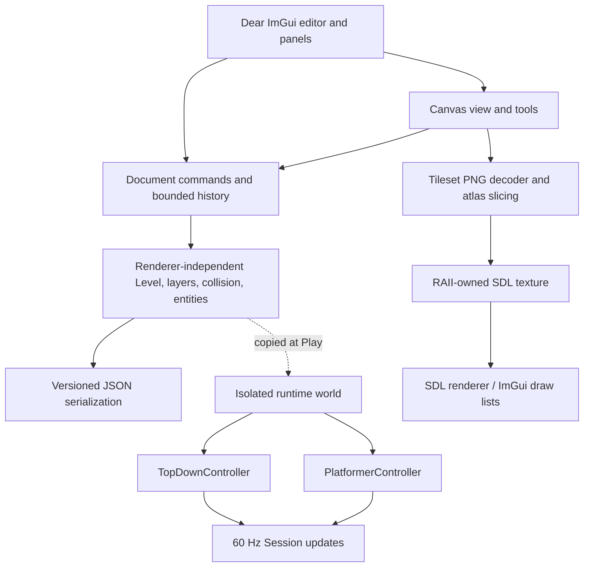

# PixelForge

A C++20 native 2D level editor for top-down RPGs and platformers. Both genres use the same tile canvas, layer model, and JSON format. Studio Beta builds on Alpha's textured editing, undo history, structured collision/entity data, isolated playtest runtime, and portable Windows package.

## Windows build

Install Visual Studio 2022 with **Desktop development with C++**, Git, and CMake 3.24+. In a Developer PowerShell, from the checkout root:

```powershell
cmake -S . -B build -A x64
cmake --build build --config Release --parallel 2
ctest --test-dir build -C Release --output-on-failure
.\build\Release\PixelForge.exe
```

CMake FetchContent downloads pinned SDL 3.2.10, Dear ImGui 1.91.9b docking, nlohmann JSON 3.12.0, and stb_image sources from GitHub. SDL is linked statically; no separately installed SDL DLL is required. Internet and Git are needed for the first configure; build/_deps retains dependencies. Dependency licenses are in the fetched source directories. GitHub Actions builds/tests Linux and Windows and uploads a portable Windows ZIP with the executable, demos, tileset, and license notices.

Linux requires GCC 12+/Clang with C++20, CMake, Git, a build tool and desktop development libraries (on Debian: libx11-dev libxext-dev libxrandr-dev libxcursor-dev libxi-dev libxfixes-dev libxss-dev libxtst-dev).

```sh
cmake -S . -B build -DCMAKE_BUILD_TYPE=Debug
cmake --build build --parallel 2
ctest --test-dir build --output-on-failure
./build/PixelForge
```

On a displayless Linux host add `-DSDL_UNIX_CONSOLE_BUILD=ON` at configure; this permits an SDL build without desktop libraries. `SDL_VIDEODRIVER=dummy ./build/PixelForge --smoke` renders three frames using the real SDL/ImGui backends and exits. It does not validate interactive desktop behavior. Core-only development: configure with `-DPIXELFORGE_EDITOR=OFF`.

## Windows package

Download the `PixelForge-Windows` artifact from a successful GitHub Actions run and unzip it. Run `PixelForge.exe` from the package directory. The package contains `assets/studio_tiles.png`, both example levels, this README, and the license texts for the statically linked dependencies. The executable uses the statically linked MSVC runtime and SDL; no separate SDL or Visual C++ runtime installation is expected.

## Editing

The editor creates maps from 1–256 cells per dimension with either `top_down_rpg` or `platformer` genre. The original procedural pixel-art PNG atlas is loaded from `assets/studio_tiles.png`; the palette lets you load another PNG and set its tile width/height. Select a palette tile and use Pencil to paint. The toolbar also provides Eraser, Rectangle, Line, Flood Fill, and Eyedropper. Pencil drag fills every crossed cell and is one undoable action. Ctrl+Z undoes; Ctrl+Y or Ctrl+Shift+Z redoes. Grid visibility, Fit, and 100% reset are available in the toolbar. Middle-drag pans; the wheel zooms around the cursor. Panels can be docked by dragging their title bars. Layout persists in imgui.ini in the working directory.

Use File → Open, Save, or Save As to work with JSON levels through the native platform file picker. File → Import PNG tileset selects an image without typing a path. Bundled assets resolve from the executable folder (with a source-tree fallback for development); level assets resolve beside the JSON first. Saving packages a selected tileset beside the level and atomically replaces the JSON file. Open, New, and Exit protect dirty documents with save/discard/cancel prompts. File and asset failures appear in a modal with a clear error message. Ctrl+S saves, Ctrl+Shift+S opens Save As, and Ctrl+O opens the picker.

The Layers panel supports creating, renaming, deleting, reordering, hiding, locking, and selecting layers. A level always retains at least one layer. Higher rows draw above lower rows; hidden layers are not rendered, and locked layers cannot be edited. Errors appear in the status bar; a failed load preserves the current level. The Entity tool places and moves entities; the Entities panel edits type, position, name/message properties, and deletion. The Collision tool paints an independent solid grid with an optional overlay.

Click **Play** to run an isolated copy of the current level. Click the canvas to focus controls. Arrows or WASD move; Space or Up jumps in the platformer; E interacts with nearby RPG NPCs. Pause, Reset, and Stop are in the toolbar. Runtime collection, movement, and checkpoints do not modify the editor document. F3 or View → Playtest collision debug toggles collision-tile and player-hitbox outlines plus position, velocity, grounded state, support/contact information, camera position, and scale. Ctrl+S saves, Ctrl+Shift+S saves to the path in the Level JSON field, and Ctrl+O/Ctrl+N prompt before discarding unsaved edits.

## Architecture

- `application`: RAII SDL window/renderer and ImGui lifecycle, event/render loop.
- `editor`: workspace, tools, input, zoom/pan and active document.
- `document`: renderer-independent grouped editing commands and bounded history.
- `tileset`: PNG atlas slicing and RAII SDL texture ownership.
- `rendering`: tile rendering helpers.
- `level`: shared tile/layer/collision/entity model, independent of SDL.
- `serialization`: strict versioned JSON validation and filesystem I/O, independent of UI.
- `gameplay`: runtime world conversion, fixed-step session, shared collision, and isolated top-down/platformer controllers.

Version 2 saves include genre, map and tile dimensions, a safe relative tileset reference and atlas cell size, ordered visual layers with visibility/lock state, row-major tile data, an explicit boolean collision grid, and typed entities with stable IDs and JSON properties. Version 1 files remain readable; missing layer state defaults to visible and unlocked, tile size defaults to 24x24, and the bundled atlas is selected. Unknown fields and unsupported versions are rejected instead of discarded. Paths must be relative and cannot traverse upward. Inputs and serialized documents are capped at 16 MiB.

Model tests cover geometry and collision bounds, v1 migration, v2 round-trips for both genres, unsafe references, malformed/unknown data, duplicate entity IDs, missing assets, and bundled examples. Document tests cover grouped tile and collision strokes, undo/redo, layer operations, entity CRUD, invalid coordinates, asset settings, and dirty state. The editor smoke test draws Welcome, loads both example documents through the executable resource root, repeats runtime start/stop, and renders the original tileset and runtime sprite/entity shapes through SDL and Dear ImGui on the dummy video driver.

## Validation and limitations

Use CTest as above. The automated test programs currently report 81 model/serialization checks, 62 document/undo checks, and 74 gameplay checks. CTest also starts the real SDL/ImGui editor with its bundled PNG atlas using the dummy video driver. Manually on Windows, verify native open/save/import dialogs, entity/collision editing, and both example playtests; the headless smoke test cannot prove Windows dialog behavior or interactive visual quality.

Genuine application screenshots are not included yet. The runtime is a minimal playtest: enemies have no AI, triggers only display a message, character animation is a small procedural two-frame treatment, and audio is absent. Interactive desktop behavior and Windows runtime still require manual verification.

## Studio Alpha Phase 1

The current `codex/pixelforge-studio-alpha` branch adds a shared image-based editor on top of the Milestone 1 model. The original `work` branch and PR #1 remain the base. `Level` stays independent of graphics resources; a renderer-independent `Document` owns bounded undo/redo history, and the editor/tileset boundary owns PNG decoding and SDL textures.

A small original pixel-art atlas is included at `assets/studio_tiles.png` under CC0 terms in `assets/LICENSE.txt`. The Tileset Palette loads PNG atlases, slices them by configurable tile width/height, displays selectable previews, and uses nearest-neighbor texture sampling with alpha. Image dimensions must be divisible by tile size and stay under 16 megapixels. The renderer reports invalid atlas indices instead of silently drawing the wrong tile.

The toolbar offers Pencil, Eraser, Rectangle, Line, Flood Fill, Eyedropper, grid toggle, Fit, and 100% reset. Pencil strokes interpolate every crossed cell and form one undo entry. Ctrl+Z undoes; Ctrl+Y or Ctrl+Shift+Z redoes. No-op edits do not enter history; history retains up to 64 operations and 16 MiB of deltas/snapshots. The Layers panel creates, renames, deletes, reorders, hides, locks, and selects layers. The only remaining layer cannot be deleted. Layer visibility and locks save in version 2 JSON; old version 1 files default to visible and unlocked.

The Tileset Palette provides new genre/dimension inputs plus a level path for Open and Save. Ctrl+N, Ctrl+O, and Ctrl+S are supported while the canvas has keyboard focus. Wheel zooms around the pointer, middle-drag pans, Fit centers the level, and the grid can be hidden. Layer list order matches draw order: higher rows appear over lower rows.

The model test suite now covers grouped strokes and interpolation, undo/redo and branch invalidation, lines, rectangles, fill, bounded history, and undoable layer state. The SDL smoke check loads the bundled PNG, initializes ImGui/SDL rendering, verifies the atlas was accepted, and draws frames on the dummy video driver.

### Architecture sketch



## Studio Alpha Phase 2

Phase 2 adds a renderer-independent entity model (player spawn, NPC, enemy, collectible, trigger, checkpoint, hazard) and explicit solid-cell collision data. The canvas exposes collision paint/erase with an overlay and entity placement, selection, dragging, deletion, and a basic property inspector. Entity and collision edits participate in undo/redo. Version 2 JSON persists all world-building data and remains able to load version 1 files. The two examples now include collision and representative RPG/platformer entities. See [Phase 2 design notes](docs/studio-alpha-phase2.md).

## Studio Alpha Phase 3

The built-in playtest runs a renderer-independent copy of the current level at a fixed 60 Hz. `TopDownController` handles normalized four-direction movement, collision, NPC interaction, and collectibles. `PlatformerController` handles horizontal movement, gravity, jumping, tile collision, checkpoints, hazards, and respawn. Both share the same tile collision and runtime contact handling; platformer space below the map is a fall zone while the top-down map bounds remain solid. Phase 1 adds exact hitbox/tile contact resolution, visible collision diagnostics, and expanded regression tests; see [Phase 3 notes](docs/studio-alpha-phase3.md) and [Studio Beta Phase 1](docs/studio-beta-phase1-physics.md).

## Studio Alpha Phase 4

Level saves use a temporary sibling file and atomically replace the destination after a successful write. The original Alpha path-entry workflow has been replaced in Studio Beta by native SDL3 dialogs; see Phase 3 below. The portable Windows ZIP is available from GitHub Actions.

## Studio Beta Phase 1

Platformer rendering and collision use the same 0.62 × 0.78 tile-unit hitbox, and tile contacts resolve to exact surfaces. Platformer falls below the map now reach the respawn path while top-down map bounds remain solid. View → Playtest collision debug (or F3 while the playtest canvas is focused) shows collision cells, hitbox, player state, support/contact data, normals, and camera transform. See [Phase 1 physics notes](docs/studio-beta-phase1-physics.md).

## Studio Beta Phase 2

The editor now starts with a responsive docked workspace: tileset/tools on the left, canvas or playtest in the center, layers and entity properties on the right, and status at the bottom. Panels resize with the client viewport, the layout is stored in `imgui.ini`, and View → Reset workspace layout restores the default arrangement. View → UI scale selects 100%, 125%, 150%, or 200%; SDL display-scale changes update the generated Dear ImGui font atlas and widget metrics. Canvas coordinates remain in SDL/ImGui logical pixels. The toolbar groups play, undo/redo, active tool, grid/collision, and view controls. The status bar shows document, genre, layer, cursor tile, tool, zoom, and messages. A restrained dark palette supplies the application style.

## Studio Beta Phase 3

File → Open/Save As and PNG import use SDL3 native dialogs. Bundled resources resolve relative to the executable, and document assets resolve beside the level before the explicit resource root. Save packages the selected atlas next to the JSON document and retains atomic JSON replacement. Safe relative asset references reject POSIX roots, Windows drive/UNC roots, and traversal. See [Phase 3 file-operation notes](docs/studio-beta-phase3-files.md).

## Studio Beta Phase 4

First launch opens a dismissible welcome workspace with genre-specific New actions, Open, one-click RPG and platformer demos, and concise controls/objectives. Example loading continues through the same dirty-document guard and serialization path as normal Open. The RPG objective is to talk with Mira and find the Moon crystal; the platformer objective is to cross the hazard gap, reach the checkpoint, and touch Finish. The packaged example levels are included in the Windows artifact.

## Studio Beta Phase 5

Playtest characters are now drawn as an original pixel-style explorer fitted to the shared collision bounds, with direction, a simple walking cycle, and distinct jump/fall leg poses. Runtime NPCs, enemies, collectibles, hazards, checkpoints, spawn markers, and triggers have genre-neutral visual symbols. In RPG playtest, approaching an NPC shows an E-to-talk prompt. The visual primitives are authored in the renderer and add no third-party art assets. See [Phase 5 presentation notes](docs/studio-beta-phase5-presentation.md).

## Studio Beta Phase 6

Successful document replacement and New now stop an active playtest, while failed loads preserve both the current document and play session. The smoke workflow exercises startup, RPG and platformer demo loading, repeated playtest start/stop, and the sprite/entity drawing path at several window sizes and scales. Missing relative assets have a model regression test. The three core suites pass ASan/UBSan with leak detection on Linux; see [Phase 6 hardening notes](docs/studio-beta-phase6-hardening.md).
