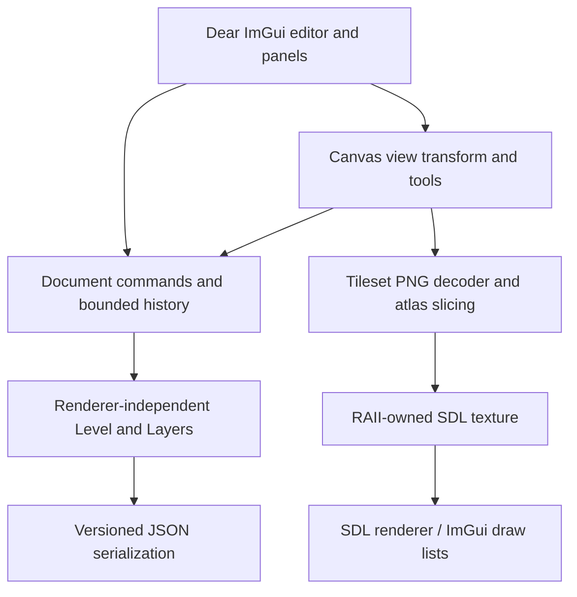

# PixelForge

A C++20 native 2D level editor for top-down RPGs and platformers. Both genres use the same tile canvas, layer model and JSON format. The Studio Alpha branch builds on the native editing foundation with textured tiles, undoable editing, structured collision and entity data, and versioned level files. Playtest runtime is not implemented yet.

## Windows build

Install Visual Studio 2022 with **Desktop development with C++**, Git, and CMake 3.24+. In a Developer PowerShell, from the checkout root:

```powershell
cmake -S . -B build -A x64
cmake --build build --config Release --parallel 2
ctest --test-dir build -C Release --output-on-failure
.\build\Release\PixelForge.exe
```

CMake FetchContent downloads pinned SDL 3.2.10, Dear ImGui 1.91.9b docking, nlohmann JSON 3.12.0, and stb_image sources from GitHub. SDL is linked statically; no separately installed SDL DLL is required. Internet and Git are needed for the first configure; build/_deps retains dependencies. Dependency licenses are in the fetched source directories. GitHub Actions builds/tests Linux and Windows and uploads the Windows executable.

Linux requires GCC 12+/Clang with C++20, CMake, Git, a build tool and desktop development libraries (on Debian: libx11-dev libxext-dev libxrandr-dev libxcursor-dev libxi-dev libxfixes-dev libxss-dev libxtst-dev).

```sh
cmake -S . -B build -DCMAKE_BUILD_TYPE=Debug
cmake --build build --parallel 2
ctest --test-dir build --output-on-failure
./build/PixelForge
```

On a displayless Linux host add `-DSDL_UNIX_CONSOLE_BUILD=ON` at configure; this permits an SDL build without desktop libraries. `SDL_VIDEODRIVER=dummy ./build/PixelForge --smoke` renders three frames using the real SDL/ImGui backends and exits. It does not validate interactive desktop behavior. Core-only development: configure with `-DPIXELFORGE_EDITOR=OFF`.

## Editing

The editor creates maps from 1–256 cells per dimension with either `top_down_rpg` or `platformer` genre. The original procedural pixel-art PNG atlas is loaded from `assets/studio_tiles.png`; the palette lets you load another PNG and set its tile width/height. Select a palette tile and use Pencil to paint. The toolbar also provides Eraser, Rectangle, Line, Flood Fill, and Eyedropper. Pencil drag fills every crossed cell and is one undoable action. Ctrl+Z undoes; Ctrl+Y or Ctrl+Shift+Z redoes. Grid visibility, Fit, and 100% reset are available in the toolbar. Middle-drag pans; the wheel zooms around the cursor. Panels can be docked by dragging their title bars. Layout persists in imgui.ini in the working directory.

Enter a JSON path in the Tileset Palette panel and click Open or Save. Relative paths resolve from the directory where the app was launched; from the checkout root try `examples/rpg.json` and `examples/platformer.json`. Loading and creating a new map prompt before discarding edits. Closing the application currently does not prompt, so save before exiting. Save overwrites the named file directly; keep backups for important maps.

The Layers panel supports creating, renaming, deleting, reordering, hiding, locking, and selecting layers. A level always retains at least one layer. Higher rows draw above lower rows; hidden layers are not rendered, and locked layers cannot be edited. Errors appear in the status bar; a failed load preserves the current level.

## Architecture

- `application`: RAII SDL window/renderer and ImGui lifecycle, event/render loop.
- `editor`: workspace, tools, input, zoom/pan and active document.
- `document`: renderer-independent grouped editing commands and bounded history.
- `tileset`: PNG atlas slicing and RAII SDL texture ownership.
- `rendering`: tile rendering helpers.
- `level`: shared tile/layer/collision/entity model, independent of SDL.
- `serialization`: strict versioned JSON validation and filesystem I/O, independent of UI.
- `gameplay`: reserved boundary for genre controllers; no physics or simulation yet.

Version 2 saves include genre, map and tile dimensions, a safe relative tileset reference and atlas cell size, ordered visual layers with visibility/lock state, row-major tile data, an explicit boolean collision grid, and typed entities with stable IDs and JSON properties. Version 1 files remain readable; missing layer state defaults to visible and unlocked, tile size defaults to 24x24, and the bundled atlas is selected. Unknown fields and unsupported versions are rejected instead of discarded. Paths must be relative and cannot traverse upward. Inputs and serialized documents are capped at 16 MiB.

Model tests cover geometry and collision bounds, v1 migration, v2 round-trips for both genres, unsafe references, malformed/unknown data, duplicate entity IDs, and bundled examples. Document tests cover grouped tile and collision strokes, undo/redo, layer operations, entity CRUD, invalid coordinates, asset settings, and dirty state. The editor smoke test loads the bundled PNG through stb_image and SDL, then renders using the dummy video driver.

## Validation and limitations

Use CTest as above. The current automated test programs report 42 model checks and 50 document checks; CTest also starts the real SDL/ImGui editor with its bundled PNG atlas. Manually on Windows: open both examples, paint/erase, use each tool, undo/redo a stroke and layer operation, hide/lock layers, zoom/pan/fit, save and reopen. A dummy-driver smoke pass cannot establish interactive desktop input or visual quality.

No native file picker, close-time unsaved prompt, atomic save, gameplay runtime, Windows ZIP package, or genuine screenshots are included yet. Phase 2 introduces editable entity and collision data, but the controllers and playtest mode remain future work. Interactive desktop behavior and Windows runtime still require manual verification.

## Studio Alpha Phase 1

The current `codex/pixelforge-studio-alpha` branch adds a shared image-based editor on top of the Milestone 1 model. The original `work` branch and PR #1 remain the base. `Level` stays independent of graphics resources; a renderer-independent `Document` owns bounded undo/redo history, and the editor/tileset boundary owns PNG decoding and SDL textures.

A small original pixel-art atlas is included at `assets/studio_tiles.png` under CC0 terms in `assets/LICENSE.txt`. The Tileset Palette loads PNG atlases, slices them by configurable tile width/height, displays selectable previews, and uses nearest-neighbor texture sampling with alpha. Image dimensions must be divisible by tile size and stay under 16 megapixels. The renderer reports invalid atlas indices instead of silently drawing the wrong tile.

The toolbar offers Pencil, Eraser, Rectangle, Line, Flood Fill, Eyedropper, grid toggle, Fit, and 100% reset. Pencil strokes interpolate every crossed cell and form one undo entry. Ctrl+Z undoes; Ctrl+Y or Ctrl+Shift+Z redoes. No-op edits do not enter history; history retains up to 64 operations and 16 MiB of deltas/snapshots. The Layers panel creates, renames, deletes, reorders, hides, locks, and selects layers. The only remaining layer cannot be deleted. Layer visibility and locks save in version 2 JSON; old version 1 files default to visible and unlocked.

The Tileset Palette provides new genre/dimension inputs plus a level path for Open and Save. Ctrl+N, Ctrl+O, and Ctrl+S are supported while the canvas has keyboard focus. Wheel zooms around the pointer, middle-drag pans, Fit centers the level, and the grid can be hidden. Layer list order matches draw order: higher rows appear over lower rows.

The model test suite now covers grouped strokes and interpolation, undo/redo and branch invalidation, lines, rectangles, fill, bounded history, and undoable layer state. The SDL smoke check loads the bundled PNG, initializes ImGui/SDL rendering, verifies the atlas was accepted, and draws frames on the dummy video driver.

### Architecture sketch



## Studio Alpha Phase 2

Phase 2 adds a renderer-independent entity model (player spawn, NPC, enemy, collectible, trigger, checkpoint, hazard) and explicit solid-cell collision data. The canvas exposes collision paint/erase with an overlay and entity placement, selection, dragging, deletion, and a basic property inspector. Entity and collision edits participate in undo/redo. Version 2 JSON persists all world-building data and remains able to load version 1 files. The two examples now include collision and representative RPG/platformer entities. See [Phase 2 design notes](docs/studio-alpha-phase2.md).
